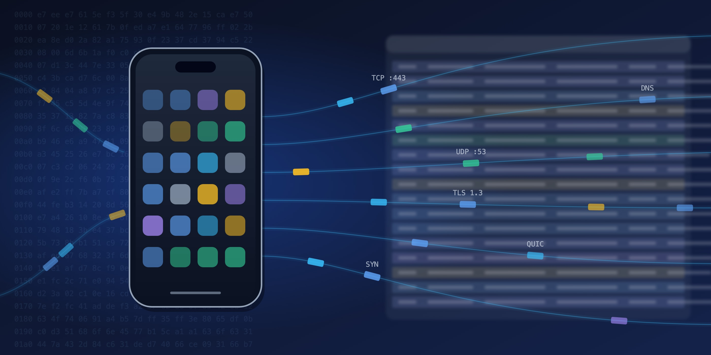
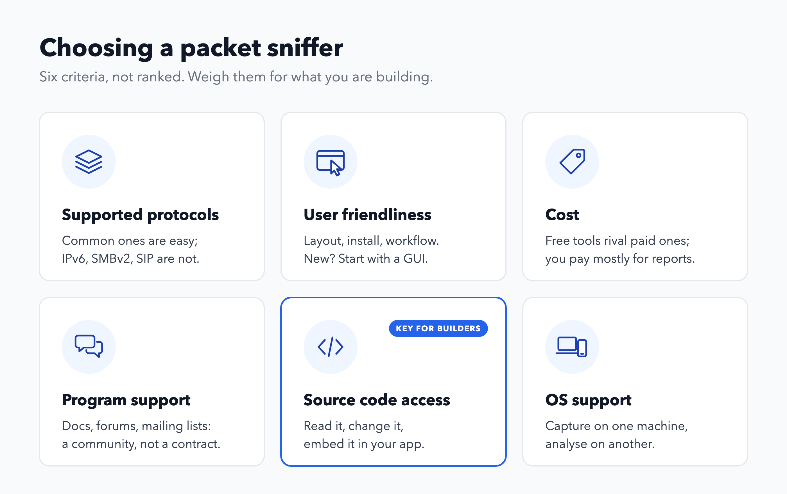
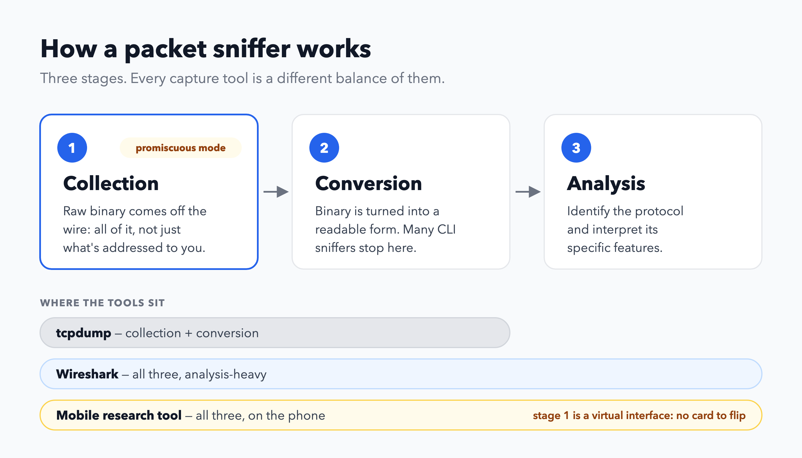
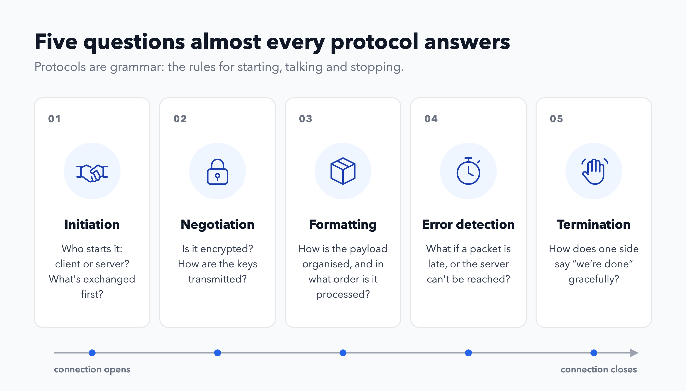
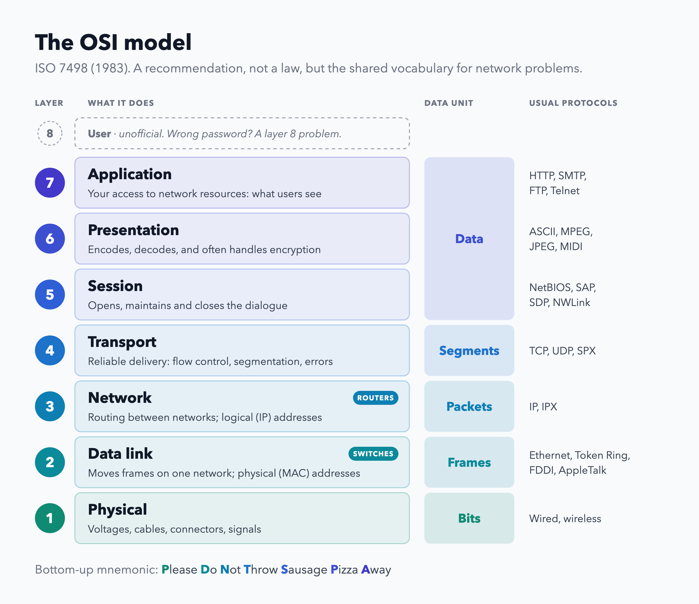
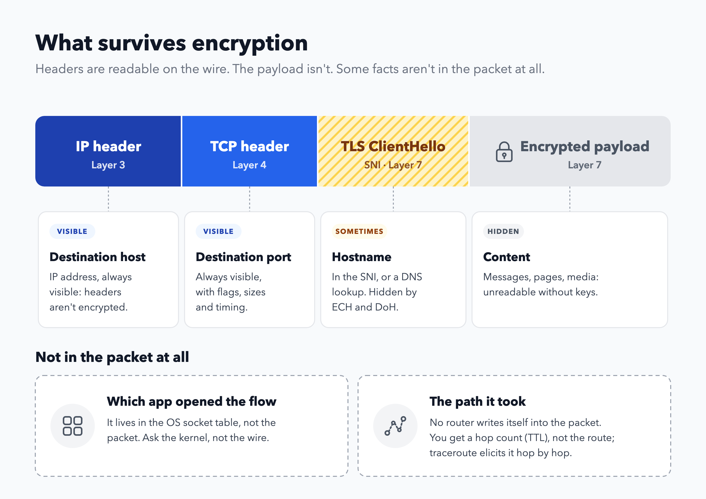
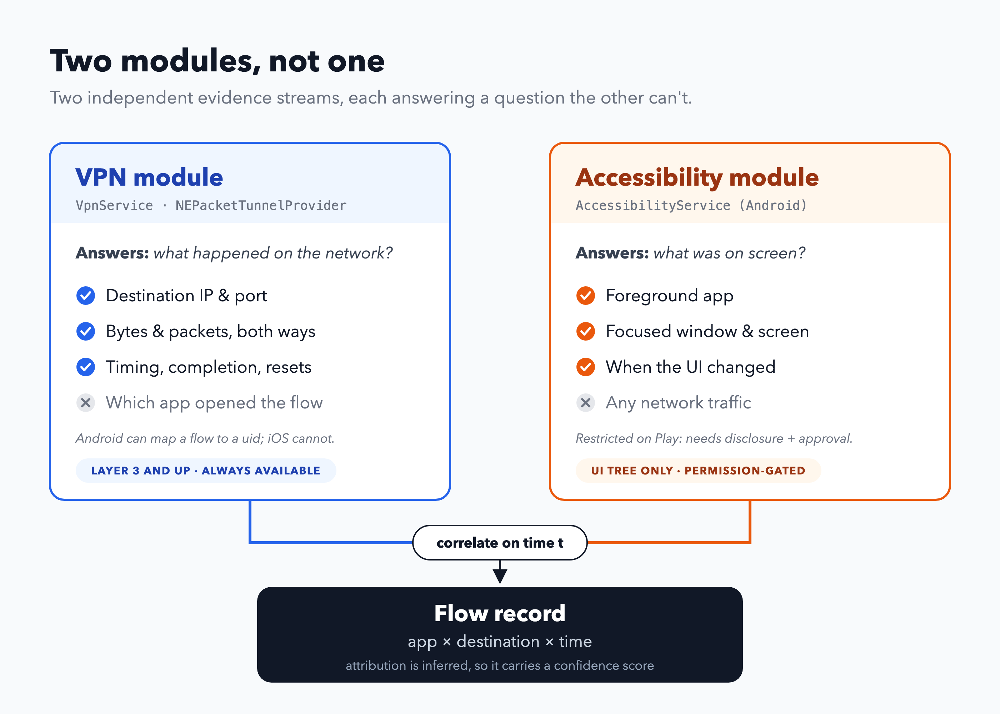
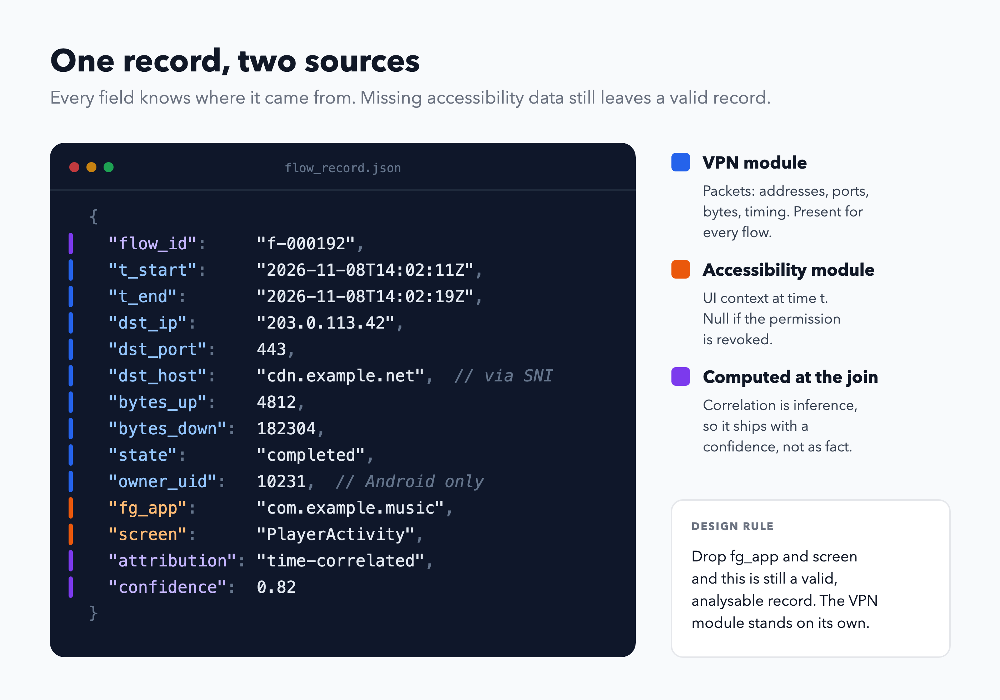

# I Read 7 Pages of a Packet Analysis Book and It Changed How I Think About My Phone

*A mobile researcher's notes on Chapter 1 of Practical Packet Analysis — and why the
OSI model is the vocabulary you need before you build anything.*

**Reading time:** ~18 minutes

---

---

## The problem with trusting the app

I build a research tool that watches network traffic on mobile devices in order to
collect **behavioural data**. Not click counts, not survey answers — what the device
actually does on the network, observed from the wire rather than self-reported.

The project is the mobile successor to **GESIS Surf** (Ramirez, Mangold & Stier,
arXiv:2610.41441), our open-source infrastructure for longitudinal web-behavioural
data collection. GESIS Surf runs as a browser extension on desktop: it passively
captures user interactions, page metadata, and HTML snapshots, and wraps every
observation in a hierarchical session model. It works because a browser is a
well-behaved, single-purpose observation point.

A phone is not. There is no page, no DOM, no extension API. There is a network.

So the mobile version has to answer the same research questions from a much poorer
vantage point — and that's what pulled me into packet analysis. The more I built
it, the more I noticed something uncomfortable: everything I knew about what a phone
was doing came from the app's own interface.

The app tells me what it wants me to see.

Chapter 1 of *Practical Packet Analysis* (Chris Sanders) opens by saying exactly
that, and rather more bluntly. At the packet level, *"even the prettiest-looking
applications can reveal their horrible implementations and seemingly trustworthy
protocols can prove malicious."* Nothing is obscured by a friendly menu or a
polished screen.

And the one genuinely hidden thing? Encryption. Everything else is visible.

That single paragraph reframed my whole project. I stopped asking *"what does the
app say it's doing?"* and started asking *"what can I prove from the wire?"*

---

## What packet analysis actually is

**Packet analysis** — also called packet sniffing or protocol analysis — is
capturing live data as it crosses a network and interpreting it to understand what
that network is doing.

The tool that does it is a **packet sniffer**. Wireshark if you want a GUI,
tcpdump if you want a terminal. I live in both.

The important framing for me: packet analysis is an *interpretive* act. Capturing
is mechanical. **Understanding is the job.**

---

## What it's genuinely good for

Sanders lists six things. I'll be honest — in my notes I'd only written down four,
and the two I missed turned out to be the ones most relevant to a research tool.

1. **Understanding network characteristics** — what kind of network is this, really?
2. **Learning who is on a network** — device inventory, before you trust anything else.
3. **Determining who or what is utilising available bandwidth** — the "why is this
   slow" question.
4. **Identifying peak network usage times** — baselines, not anecdotes.
5. **Identifying malicious activity** — scans, poisoning, command-and-control chatter.
6. **Finding unsecured and bloated applications** — the apps that talk too much.

Numbers 3 and 5 were the ones I'd skipped. Both are things a research panel
desperately needs and that an app's own telemetry will never tell you.

---

## If you're choosing a sniffer, check six things

I originally wrote down only "supported protocols" — the obvious one. The book lists
six, and they're not ranked, which matters:

- **Supported protocols.** Most sniffers handle IPv4, ICMP, TCP, UDP, DNS, HTTP.
  Newer things — IPv6, SMBv2, SIP — are where they fall down.
- **User friendliness.** Layout, install effort, workflow. If you're new to this,
  stay away from command-line tools for now.
- **Cost.** Free tools genuinely rival commercial ones. What you pay for in
  commercial products is mostly reporting.
- **Program support.** Docs, forums, mailing lists. Free tools rarely come with a
  support contract — they come with a community.
- **Source code access.** Open source means you can read it and change it. This one
  decided my architecture: if I'm embedding a capture engine in an app, this isn't
  a nice-to-have.
- **Operating system support.** You'll often capture on one machine and analyse on
  another. Plan for that split.

That last point about source code is, in my opinion, the most underrated line in
the chapter for anyone building a product rather than troubleshooting a network.

---

## How a sniffer actually works — the mental model I keep using

Three stages, and only one of them is hard:

1. **Collection.** Raw binary data comes off the wire. Usually this means putting
   the network card into **promiscuous mode**, so it hands up *all* traffic on the
   segment, not just traffic addressed to it.
2. **Conversion.** The binary is turned into something readable. Most advanced
   command-line sniffers stop here and leave the analysis to you.
3. **Analysis.** The sniffer identifies the protocol and interprets its specific
   features.

The reason this model stuck with me: **every capture tool you'll ever use is just a
different balance of those three stages.** Wireshark pushes stage 3 hard. tcpdump
stops at stage 2. My mobile tool has to do all three on a phone, which is a very
different engineering problem — and the reason is entirely about stage 1.

**Promiscuous mode is the whole ballgame on mobile.** On a phone you don't get a
network card to flip; you get a virtual interface. Android's `VpnService` hands you a
file descriptor of raw IP packets. That's a tap — but a very particular kind of tap,
and much later in the book Sanders explains exactly why placement decides what you
can see.

---

## How computers actually talk

A network is a crowd of different systems and platforms. What they share is a set
of common languages called **protocols** — TCP, IP, ARP, DHCP — and a group of
protocols that work together is called a **protocol stack**.

The analogy in the book is the one I'd use with anyone: protocols are the grammar
rules of human language. Every language has rules for conjugating verbs, greeting
people, thanking someone. Protocols work the same way — they define how packets get
routed, how a connection starts, how receipt is acknowledged.

### Five questions almost every protocol answers

This list is the part of the chapter I've used most often since reading it:

- **Connection initiation.** Who starts it — client or server — and what has to be
  exchanged first?
- **Negotiation of connection characteristics.** Is the protocol encrypted? How are
  keys transmitted?
- **Data formatting.** How is the payload organised, and in what order is it
  processed?
- **Error detection and correction.** What happens when a packet is late, or when a
  client can't reach a server at all?
- **Connection termination.** How does one side say "we're done" gracefully?

Notice that the encryption question lives *inside* protocol design, not beside it.
That's why "just don't encrypt it" was never an option, and why the interesting
questions are all about what's left visible once encryption is on.

---

## The OSI model, in the least boring way I can manage

The **OSI model** is a seven-layer reference model published by ISO in 1983 as
document ISO 7498. Protocols are separated by function, layer by layer.

Crucially: **it is a recommendation, not a law.** Nobody is required to follow it.
The TCP/IP (DoD) model is a legitimate alternative. But you should know it cold,
because — as the book puts it — it gives you *a useful vocabulary for describing
network problems*.

Seven layers, top to bottom:

- **7 — Application.** Your access to network resources. The only layer end users
  ever see.
- **6 — Presentation.** Transforms data into something the application layer can
  read. Encoding, decoding, and a good deal of encryption handling.
- **5 — Session.** Manages the dialogue between two machines — establishing it,
  keeping it, ending it, and deciding duplex versus half-duplex.
- **4 — Transport.** Reliable delivery: flow control, segmentation, error control.
  Both connection-oriented and connectionless protocols live here.
- **3 — Network.** The most complex layer. Routing between physical networks, and
  *logical addressing* of hosts — IP addresses. Routers live here.
- **2 — Data link.** Transporting data across a physical network, with an addressing
  scheme for *physical* devices — MAC addresses. Switches live here.
- **1 — Physical.** Voltages, cabling, connectors. Signal conversion between digital
  and analogue.

Mnemonic, if you need one: *Please Do Not Throw Sausage Pizza Away.*

And the joke worth knowing, because it explains half of all IT tickets: a user
failing to log in because of a wrong password is a **layer 8** problem. Layer 8 is
the unofficial user layer.

### The vocabularies each layer carries

Two details from around this part of the chapter that are easy to skim past and
worth keeping:

**Each layer has a name for the data it handles.** The application, presentation and
session layers just call it *data*. The transport layer calls it *segments*, the
network layer *packets*, the data link layer *frames*, and the physical layer *bits*.
This comes straight off the figure in the book, and it's the vocabulary everyone
else assumes you have.

**Each layer has its usual suspects.** Application: HTTP, SMTP, FTP, Telnet.
Presentation: ASCII, MPEG, JPEG, MIDI. Session: NetBIOS, SAP, SDP, NWLink. Transport:
TCP, UDP, SPX. Network: IP, IPX. Data link: Ethernet, Token Ring, FDDI, AppleTalk.
Physical: wired, wireless.

---

## Why any of this matters if you're building something

Here's where my own project reframed the chapter.

If you're building anything that observes mobile traffic, the OSI model stops being
an exam topic and becomes a **map of what you're allowed to know**.

- **Destination host** lives at layer 3 — the IP address. Always visible. Headers
  are never encrypted.
- **Destination port** lives at layer 4. Always visible.
- **Destination hostname** lives at layer 7 — in DNS, or in the TLS SNI. Visible
  *sometimes*: DNS-over-HTTPS hides the first, and Encrypted Client Hello hides the
  second.
- **Which app opened the connection** is layer 7 too — but it isn't in the packet at
  all. It lives in the operating system's socket table. You need the OS, not the
  wire.
- **The path the packet took** — the actual chain of routers — is **not in the
  headers at all**. No router writes itself into the packet. All you get is the TTL,
  which tells you how many hops remain, not which ones.

That last line is the one I wish someone had told me a year ago. No amount of packet
analysis will tell you which app a flow belongs to. That's not a limitation of your
tooling — it's a category difference between *what's on the wire* and *what's in the
kernel*.

The path is a different kind of absence. You can't read it, but you can **ask for
it**: `traceroute` sends packets with TTL 1, 2, 3 …, collects the ICMP "time
exceeded" reply from each router in turn, and thereby discovers the route one hop at
a time. The path isn't observed — it's *elicited*. Which means if your tap is
passive, you get hop counts for free and the route not at all.

And it's why the OSI model is worth memorising even though it's "just a
recommendation". It tells you, before you write a line of code, which questions are
answerable at layer 3 and which need a completely different source.

---

## So how do you actually build the thing? Two modules, not one

This is the question I get asked most, and it's the one I got wrong at first. The
temptation is to think of the VPN as *the* capture component and the accessibility
API as a helper. That's backwards. They are **two independent evidence streams that
answer two different questions**, and neither can answer the other's.

### Module 1 — the VPN: what happened on the network

On Android, a `VpnService` hands you a file descriptor of raw IP packets. On iOS,
`NEPacketTunnelProvider` gives you a `packetFlow` and a virtual interface. In both
cases you get **layer 3 and above, and nothing below** — the interface literally
starts at IP headers.

This module can tell you, with certainty:

- the destination IP and port of every flow,
- byte and packet counts in both directions,
- timings — start, end, inter-arrival,
- whether a connection completed or was reset.

It **cannot** tell you which app opened the flow. That information never enters the
packet.

One detail worth knowing before you design around this: on Android the platform does
give you a bridge — `ConnectivityManager.getConnectionOwnerUid()` maps a live
connection to the uid that owns it, and it works precisely because you *are* the
active `VpnService`. But it's Android-only. iOS has no equivalent from inside the
tunnel.

### Module 2 — accessibility: what was on screen

This is where the reframe matters. The accessibility API is **not** a network API.
It exposes the **UI tree** — which app is in the foreground, what window is focused,
what's rendered. On Android, `AccessibilityService` gives you `getRootInActiveWindow()`,
the window list, and `AccessibilityEvent.getPackageName()` on every UI event. On iOS
the equivalent surface is more restricted, but the category is the same.

So: **the accessibility module gives you the app label and the moment in time; the
VPN module gives you the flow in that same moment.**

That's the join. Not "accessibility tells me which app owns this packet" — it can't
— but "accessibility tells me which app was frontmost at `t`, and I correlate that
with the flow active at `t`."

| Question | VPN module | Accessibility module |
|---|---|---|
| What IP and port was contacted? | ✅ | ❌ |
| How many bytes, over what duration? | ✅ | ❌ |
| Did the connection succeed? | ✅ | ❌ |
| Which app is in the foreground? | ❌ | ✅ |
| Which screen / context was active? | ❌ | ✅ |
| **Which app opened this specific flow?** | partial (uid, Android only) | **inferred by correlation** |

### Three design consequences

**1. Correlation is inference, not proof.** If two apps are active in the same
second — a music player and a messaging app — a time-based join can misattribute a
flow. Report it as confidence, not as fact. This is the single biggest threat to
validity in the whole design, and it should be in your methods section, not buried.

**2. The accessibility module is fragile by design.** Google Play restricts
`AccessibilityService` to assistive use; anything else needs a prominent disclosure
and, since Android 12, an approved Permission Declaration Form. For a consented
research panel with signed agreements this is a manageable process, not a wall — but
it is a process, and it constrains both distribution and update cadence.

**3. Keep the two modules independently useful.** The VPN module should produce a
complete, valid record even when accessibility data is missing. If your analysis
collapses because a permission was revoked, the design is wrong.

### What this buys you over desktop GESIS Surf

GESIS Surf sees a page because the browser tells it. The mobile tool can't — but it
sees something the desktop tool never could: **cross-app behaviour**. Not "which
page did they read", but "which app talked to which host, how much, and when" —
across the whole device, without instrumentation inside each app.

That's a different research object, not a degraded version of the same one. It also
means the privacy story has to be correspondingly stronger: opt-in, per-app allow
lists, on-device minimisation, and no payload content at all.

---

## Where I'm going next

Chapter 1 gave me the vocabulary. Chapter 2 — *Tapping into the Wire* — is where it
gets concrete: hubs, switches, port mirroring, taps, ARP cache poisoning, and,
finally, sniffer placement in practice.

That's the chapter that will decide the architecture of my mobile tool, because a
phone is a very specific place to put a tap — and it changes what "the wire"
even means.

If you're building anything that touches network data, my advice from seven pages
in: read the model before you read the API docs. The APIs change every release. The
layers don't.

*Next in this series: Chapter 2 — Tapping into the Wire, and what changes when the
tap is inside the device instead of on the cable.*

---

## Reference

Ramirez, M. A., Mangold, F., & Stier, S. (2026). *GESIS Surf: An Open-Source
Infrastructure for Privacy-Preserving Longitudinal Web Browsing Data Collection.*
arXiv:2610.41441. <https://arxiv.org/abs/2610.41441>

Sanders, C. (2017). *Practical Packet Analysis: Using Wireshark to Solve Real-World
Network Problems* (3rd ed.). No Starch Press. Chapter 1, pp. 1–16.

<!-- not-for-publication -->

---

## Image manifest (for production)

Eight images, in running order. Image 1 is stock; the other seven are diagrams and
should be drawn to spec, because they carry the article's explanatory load.

| # | Placement | Type | Description | Alt text |
|---|---|---|---|---|
| 1 | After subtitle | Stock or illustration | Phone with packet streams, or capture window behind a phone silhouette | A smartphone with network packets flowing out of it |
| 2 | "Six things" section | Icon grid (custom) | Six criteria: protocols, usability, cost, support, source code, OS support | Six criteria for choosing a packet sniffer |
| 3 | "How a sniffer works" | **Custom diagram** | Collection → Conversion → Analysis, with a note that promiscuous mode belongs to stage 1 | Three stages of packet sniffing: collection, conversion, analysis |
| 4 | "Five questions" | Icon cards (custom) | Five questions with icons: handshake, padlock, box, clock, wave | Five questions protocols answer: initiation, negotiation, formatting, error detection, termination |
| 5 | "OSI model" | **Custom diagram — anchor image** | Vertical 7-layer stack with PDU names (Data, Segments, Packets, Frames, Bits) | The seven layers of the OSI model with protocol data unit names |
| 6 | "Why this matters" | **Custom diagram — payoff** | Packet with visible outer headers and a padlocked payload; annotate which facts survive | Packet headers visible, payload encrypted |
| 7 | "Two modules, not one" | **Custom diagram — essential** | VPN block → "IP, port, bytes, timing"; Accessibility block → "foreground app, screen context"; both converge on one flow record | VPN module and accessibility module feeding one combined flow record |
| 8 | "Three design consequences" | **Custom diagram** | One record card, fields colour-coded by source (VPN vs accessibility) | A flow record with fields sourced from VPN and accessibility modules |

### Medium formatting notes

- **Tables do not paste reliably.** All book tables were converted to bulleted
  lists, which render cleanly. Two tables remain as tables — the module-comparison
  table in "Two modules, not one" and this manifest — because they are short and
  genuinely tabular. If either pastes badly, convert to a list or an image.
  Medium's editor does support tables in recent versions, so try pasting first.
- **Bold-led lists** ("**Connection initiation.** …") render well in Medium and
  produce a clean reading rhythm.
- Section headers are `##` — Medium maps those to its H2 style, which keeps the
  article navigable in the sidebar.
- Code-style inline spans (`VpnService`) are useful for precision but don't overuse
  them in a general-audience piece.
